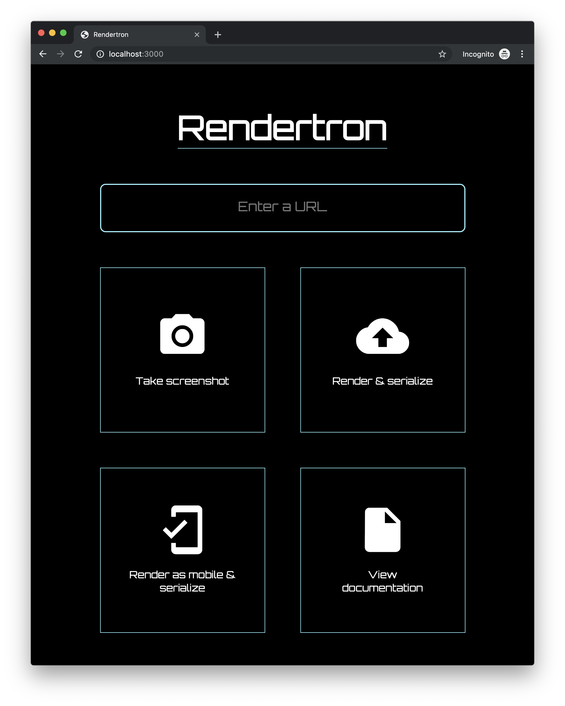

<h1 align=center>Dockette / Rendertron</h1>

<p align=center>
   <a href="https://github.com/dockette/rendertron/actions"></a>
   <a href="https://hub.docker.com/r/dockette/rendertron"></a>
   <a href="https://github.com/sponsors/f3l1x"></a>
   <a href="https://github.com/orgs/dockette/discussions"></a>
</p>

<p align=center>
   Ready-to-use image for SSR rendering based on headless Chrome.
</p>

-----

[Rendertron](https://github.com/GoogleChrome/rendertron) by Google on headless Chrome. All credits belong to the authors
of [GoogleChrome/rendertron](https://github.com/GoogleChrome/rendertron).

The upstream project is archived and its README marks it as deprecated. This image is kept for existing users and the
demo screenshot. New projects should check the alternative rendering strategies linked from the upstream README before
they use Rendertron.

## Usage

```sh
docker run -it --rm -p 3000:3000 dockette/rendertron
```



## Versions

| Version | Release |
|---------|---------|
| `dockette/rendertron:YYYY.MM.DD` | release `YYYY.MM.DD` |
| `dockette/rendertron:latest` | latest build of `master`, Rendertron on Node.js 20 and Chromium |
| `dockette/rendertron:proxy` | latest build of `master`, nginx proxy in front of Rendertron |
| `dockette/rendertron:tracer` | latest build of `master`, PHP CLI tracer that renders sitemap pages |

Only `latest` has release tags. Releases are listed on [GitHub](https://github.com/dockette/rendertron/releases).

## Development

```sh
make build-rendertron   # build dockette/rendertron
make build-proxy        # build dockette/rendertron:proxy
make build-tracer       # build dockette/rendertron:tracer
make run-rendertron     # run Rendertron on port 3000
make run-proxy          # run the proxy on port 4000, NGINX_PROXY points to Rendertron
make run-tracer         # run the tracer against a Rendertron server and sitemaps
make version            # print VERSION
make release            # set today's date in VERSION
```

## Maintenance

See [how to contribute](https://github.com/dockette/.github/blob/master/CONTRIBUTING.md) to this package. Consider to
[support](https://github.com/sponsors/f3l1x) **f3l1x**. Thank you for using this package.
